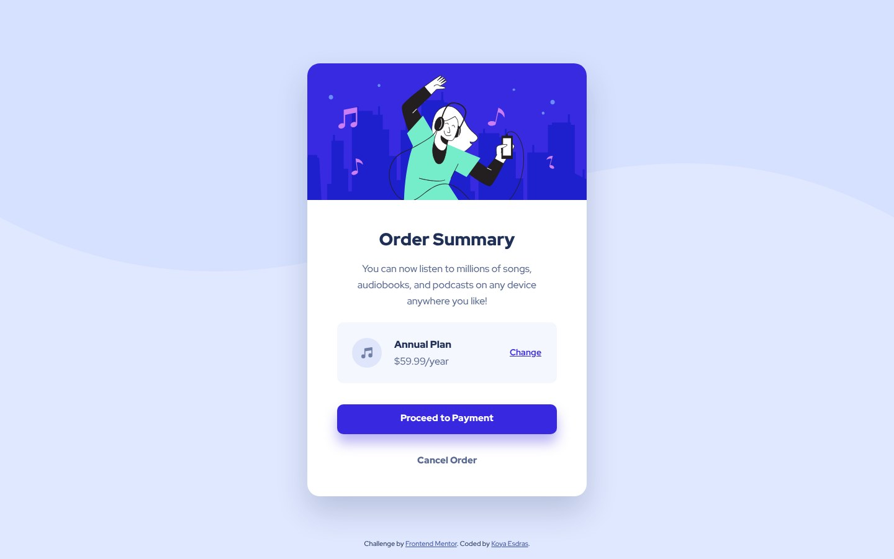

# Frontend Mentor - Order summary card solution

This is a solution to the [Order summary card challenge on Frontend Mentor](https://www.frontendmentor.io/challenges/order-summary-component-QlPmajDUj). Frontend Mentor challenges help you improve your coding skills by building realistic projects.

## Table of contents

- [Overview](#overview)
  - [Screenshot](#screenshot)
  - [Links](#links)
- [My process](#my-process)
  - [Built with](#built-with)
  - [Workflow](#workflow)
  - [What I learned](#what-i-learned)
  - [Continued development](#continued-development)
  - [Useful resources](#useful-resources)
  - [AI Collaboration](#ai-collaboration)
- [Author](#author)

## Overview

### Screenshot



### Links

- Solution URL: [frontendmentor.io/solutions/order-summary-component-cN1_pZjfrM](https://www.frontendmentor.io/solutions/order-summary-component-cN1_pZjfrM)
- Live Site URL: [ounokoya.github.io/front-ui-order](https://ounokoya.github.io/front-ui-order/)

## My process

### Built with

- Semantic HTML5: an `article` in `main`, the plan as a group named by "Annual Plan" so that "Change" relates to it, three `button type="button"` elements (the challenge gives them no destination)
- [Tailwind CSS v4](https://tailwindcss.com/) — design tokens in `@theme`, default palette removed, a 480 px `sm` breakpoint, named `focus-ring` and `link` utilities
- Red Hat Display served with the site through [Fontsource](https://fontsource.org/)
- WCAG AA colours: the design's grey text (3.92:1 on white) darkened to `hsl(224, 23%, 46%)` (5.44:1), and a hover colour that keeps white text at 5.29:1
- The wave pattern as a CSS background of the page, switching file at 480 px
- [Vite](https://vite.dev/) for the build, deployed on GitHub Pages from the `gh-pages` branch (`npm run deploy`)
- [Playwright](https://playwright.dev/), [axe-core](https://github.com/dequelabs/axe-core), the W3C Nu validator, html-validate and ESLint for tests

### Workflow

This is version 2 of my 2023 solution, rebuilt from the current starter in the same repository. Before any code, the design was analysed and rebuilt:

1. **Visual analysis in Excalidraw** — measurements in px, contrast checks, the HTML tree → [`specs/visuel/`](./specs/visuel/)
2. **Penpot mockup** — library, desktop, mobile and tablet screens, visual thresholds calibrated against the design JPGs → [`specs/visuel/penpot/`](./specs/visuel/penpot/)
3. **Spec, then tests** — 23 Given/When/Then scenarios and the accessible names the tests rely on → [`specs/specifications/`](./specs/specifications/); the tests were written before the code and checked to fail on the starter
4. **Decisions** — tokens and AA colours, fonts, images and pattern, the centred card → [`specs/adr/`](./specs/adr/)
5. **Code**, then a walk-through in a real browser → [`specs/analyse/`](./specs/analyse/)

### What I learned

**`transition-colors` also animates the focus ring.** Tailwind's colour transition includes `outline-color`: on the keyboard, the ring of "Proceed to Payment" faded in from white over 200 ms. A test reads the ring colour the moment the button gets focus; limiting the transition to the text and background fixed it:

```html
<button class="transition-[color,background-color] duration-200 motion-reduce:transition-none">
```

**Keeping the design's colours, but readable.** Only the lightness changes (55 % → 46 %), so the grey keeps its hue and the page still looks like the design.

**A box whose content is taller than expected.** The plan's two lines (27 px each) were taller than its 48 px icon, so padding made the box 104 px instead of 98; a fixed height with centred content matches the design.

### Continued development

- **Visual comparison with the design files.** Screenshots differ from the Frontend Mentor JPGs by 0.93 % (desktop), 0.94 % (hover states) and 4.20 % (mobile) of pixels; the mobile threshold is 6.3 %, because the design shifts the illustration 6 px to the left while the page keeps it full width.
- **Tablet**: my own proposal, the 450 px card from 480 px.
- At 320 px, "Annual Plan" wraps onto two lines inside the plan box.

### Useful resources

- [WebAIM — Contrast checker](https://webaim.org/resources/contrastchecker/) — checking the darkened grey and the hover colour.
- [MDN — `transition-property`](https://developer.mozilla.org/en-US/docs/Web/CSS/transition-property) — choosing what a transition animates.
- [MDN — ARIA `group` role](https://developer.mozilla.org/en-US/docs/Web/Accessibility/ARIA/Reference/Roles/group_role) — naming the plan for the "Change" button.

### AI Collaboration

I used **Claude (Claude Code)** as a pair, inside my own spec-driven workflow where I validated each step before the next one:

- **Planning**: Claude listed my old solutions that needed a rebuild and wrote the plan, which I validated.
- **Design analysis and mockup**: Claude measured the JPG designs, drew the annotated Excalidraw analysis and built the Penpot mockup; I reviewed both and decided on the AA colours, the button markup, the decorative images and the tablet layout.
- **Spec and tests**: written by Claude before any code, from the validated mockup.
- **Technical decisions**: fonts from Fontsource, as in my earlier solutions without font files in the starter.
- **Code**: written by Claude from the spec — I confirmed this split at the code lock — with the tests run at each step.

What worked well: comparing the page with the design pixel by pixel explained every difference before it was fixed. The walk-through in a real browser caught the fading focus ring, which no screenshot shows. What needed my decisions: the choices listed above.

## Author

- Frontend Mentor - [@ounokoya](https://www.frontendmentor.io/profile/ounokoya)
- GitHub - [@ounokoya](https://github.com/ounokoya)
